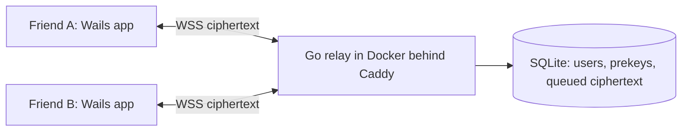

# CoffeeChat

A private, **end-to-end encrypted** desktop messenger for a small circle of close friends.

Discord, Teams, Slack, Messenger and iMessage all hold your conversations on their servers. With CoffeeChat, our messages are encrypted on our own PCs before they leave, and only the recipients can decrypt them. The relay server we host ourselves only ever sees ciphertext, deletes it once it's delivered, and history lives only on our own machines.

> This is a learning project. It's being built milestone by milestone (see [Roadmap](#roadmap)).

## Target design

| Area | Choice |
|---|---|
| Architecture | Self-hosted relay server (sees only ciphertext) + desktop clients |
| Server | Go, Docker on a small VPS, Caddy for TLS |
| Client | [Wails v2](https://wails.io) (Go) + React + TypeScript |
| Crypto | Signal protocol (X3DH + Double Ratchet) via [`go.mau.fi/libsignal`](https://pkg.go.dev/go.mau.fi/libsignal) |
| Groups | Pairwise fan-out (each group message is encrypted once per member) |
| Onboarding | Admin-issued single-use invite codes |
| Devices | One PC per person (MVP) |
| Storage | Server deletes after delivery; local history is encrypted with a passphrase-derived key |



## Repo layout

```
cmd/server/          relay server entry point
internal/protocol/   wire types shared by server and client
internal/server/     relay server implementation
client/              Wails + React desktop app (created in M8)
playground/          throwaway crypto learning exercises (M2, M3)
docs/                threat model, protocol, deployment
```

## Development

Requires Go 1.24+.

```sh
make build   # build the relay into ./bin
make run     # build and run the relay
make test    # go test ./...
make vet     # go vet ./...
```

## Roadmap

The details of each milestone (concepts, exercises, done-when criteria) are in [docs/roadmap.md](docs/roadmap.md).

- [x] **M0** Clean slate: purge the old code and lay down the skeleton
- [ ] **M1** Threat model (`docs/threat-model.md`)
- [ ] **M2** Crypto primitives playground: AEAD, X25519, Ed25519, HKDF, Argon2id
- [ ] **M3** Signal protocol concepts: X3DH, Double Ratchet, a first libsignal test
- [ ] **M4** Wire protocol design (`internal/protocol`, `docs/protocol.md`)
- [ ] **M5** Relay: SQLite store + invite-code admin CLI
- [ ] **M6** Relay: challenge-response auth, WebSocket hub, offline queue
- [ ] **M7** Relay: prekey directory + group routing
- [ ] **M8** Wails + React client skeleton
- [ ] **M9** Encrypted local storage
- [ ] **M10** End-to-end encrypted DMs
- [ ] **M11** Group chats
- [ ] **M12** UI polish
- [ ] **M13** Deploy to a VPS

**Stretch:** safety-number verification, attachments, multi-device, Sender Keys groups, sealed sender, notifications.

