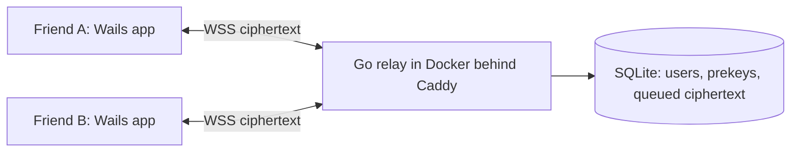

# CoffeeChat — Learning Roadmap

## What this is
**You** build CoffeeChat, a private end-to-end encrypted desktop messenger for a closed group of friends. **Copilot is the mentor.** For each milestone it explains the concepts, points to resources, sets exercises, gives hints or starter skeletons (function signatures, TODOs, tests to make pass) when you're stuck, and reviews your code when you ask. It gives the most help on the crypto. It doesn't write the app for you.

### How we work each milestone
1. Say "start milestone N".
2. Copilot explains the concepts in plain language, with diagrams where they help.
3. You do the exercises. Ask for a hint or a skeleton whenever you want.
4. Say "review". Copilot reads your diff and gives feedback (bugs, security issues, idiomatic Go/React).
5. Move on when you hit the **Done when** criteria.

## Target design (the "north star")
| Area | Choice |
|---|---|
| Architecture | Self-hosted relay server (sees only ciphertext) + desktop clients |
| Server | Go, Docker on a small VPS, Caddy for TLS |
| Client | Wails v2 (Go "brain") + React + TypeScript UI |
| Crypto | Signal protocol (X3DH + Double Ratchet) via `go.mau.fi/libsignal`. Never hand-roll crypto in the real app. |
| Groups | Pairwise fan-out (encrypt each group message once per member) |
| MVP | Text DMs + group chats |
| Onboarding | Admin-issued single-use invite codes (trust-on-first-use for now) |
| Devices | One PC per person |
| Storage | Server deletes messages after delivery. History lives only on each PC, encrypted with a passphrase-derived key. |

## Milestones

### M0 — Clean slate ✅
- Copilot purged the legacy blog code and laid down this skeleton: `cmd/server`, `internal/protocol`, `internal/server`, `playground/`, `docs/`, `client/`, plus the README, Makefile and `.gitignore`.
- **Your follow-up:** read through the skeleton and ask about anything unclear (Go module layout, why `internal/`, the Makefile).

### M1 — Threat model (no code)
- **Goal:** decide exactly what you're protecting and from whom.
- **Learn:** E2EE vs. TLS, content vs. metadata, trust-on-first-use (TOFU), MITM, what a compromised server *can* still do.
- **Exercises:** write `docs/threat-model.md` with assets, adversaries, what the server sees, and accepted MVP risks.
- **Done when:** you can explain why "the server only stores ciphertext" isn't the whole story.

### M2 — Crypto fundamentals playground (throwaway code, heavy mentoring)
- **Goal:** understand the building blocks *before* using libsignal.
- **Learn:** symmetric vs. asymmetric crypto, AEAD (XChaCha20-Poly1305), nonces, X25519 key exchange (ECDH), Ed25519 signatures, HKDF, Argon2id, why you never reuse nonces or roll your own protocol.
- **Exercises (in `playground/`, using `golang.org/x/crypto`):**
  1. Encrypt/decrypt a string with XChaCha20-Poly1305. Then tamper with one byte and watch decryption fail.
  2. Alice and Bob derive the same shared secret with X25519, then derive a key from it with HKDF.
  3. Sign a message with Ed25519 and verify it; show that a forged message fails.
  4. Derive a key from a passphrase with Argon2id.
- **Done when:** you can explain each primitive's job in one sentence.

### M3 — Signal protocol concepts (heavy mentoring)
- **Goal:** understand X3DH and the Double Ratchet conceptually, then use the library.
- **Learn:** identity keys, signed prekeys, one-time prekeys, X3DH handshake, symmetric-key ratchet, DH ratchet, forward secrecy, post-compromise security, out-of-order messages.
- **Resources:** Signal specs (X3DH, Double Ratchet) at signal.org/docs. Copilot walks through them with diagrams.
- **Exercises:**
  1. A toy "symmetric ratchet" in the playground (educational only).
  2. Use `go.mau.fi/libsignal` in a test: Alice fetches Bob's bundle, builds a session, sends 3 messages, Bob replies, with in-memory stores.
- **Done when:** the libsignal test passes and you can draw the X3DH flow from memory.

### M4 — Wire protocol design
- **Goal:** define the messages that flow between client and server.
- **Learn:** JSON vs. protobuf, envelopes, versioning, message types (register, auth challenge, prekey upload/fetch, send, deliver, ack).
- **Exercises:** `internal/protocol` package with Go types and a short `docs/protocol.md`.
- **Done when:** every client↔server interaction is written down.

### M5 — Relay server: storage + invites
- **Learn:** SQLite in Go (`modernc.org/sqlite`, no CGO), `database/sql`, migrations, generating secure random tokens (`crypto/rand`), building a CLI (`flag` or cobra).
- **Exercises:** schema for users, invites, prekeys, queued envelopes, and groups; an admin CLI `invite create`.
- **Done when:** you can create an invite from the CLI, and table-driven tests cover the store.

### M6 — Relay server: auth + WebSockets + delivery
- **Learn:** HTTP handlers, WebSockets (`github.com/coder/websocket`), goroutines/channels, challenge–response auth with Ed25519, store-and-forward, acks, rate limiting.
- **Exercises:** register with an invite code, authenticate by signing a challenge, a WS hub that delivers live or queues offline, and deletion on ack.
- **Done when:** two `websocat`/test clients can exchange opaque blobs, including when one is offline.

### M7 — Relay server: prekeys + groups
- **Learn:** prekey bundle lifecycle (consume one-time prekeys, replenish when low), basic group membership authz.
- **Done when:** tests prove one-time prekeys are handed out only once, and only members can route to a group.

### M8 — Wails + React client skeleton
- **Learn:** what Wails is, binding Go methods to JS, events from Go → UI, React + TS components/state/hooks, Vite.
- **Exercises:** `wails init -t react-ts` into `client/`, then a "hello" screen that calls a Go method.
- **Done when:** `wails dev` opens a window that round-trips data between React and Go.

### M9 — Encrypted local storage
- **Learn:** passphrase-based key derivation (Argon2id + salt), encrypting DB fields, implementing libsignal's store interfaces on top of SQLite.
- **Done when:** after restart and unlock, sessions and history load, and the DB file shows no plaintext (verify with a hex viewer).

### M10 — Client networking + E2EE DMs
- **Learn:** WS client with reconnect/backoff, the send/receive pipeline, handling `PreKeySignalMessage` vs. `SignalMessage`, identity-key-change warnings.
- **Done when:** two clients on your machine exchange encrypted DMs through the server, and the server DB contains only ciphertext.

### M11 — Group chats (pairwise fan-out)
- **Learn:** fan-out encryption, group metadata sent encrypted inside messages, member add/remove semantics.
- **Done when:** three clients chat in a group, and a removed member stops receiving messages.

### M12 — UI polish
- **Learn:** React patterns for chat (virtualized lists, optimistic sends), unlock/onboarding flows, dark mode.
- **Done when:** a friend can install it, redeem an invite, and chat without your help.

### M13 — Deploy
- **Learn:** Dockerfiles (multi-stage), docker-compose, Caddy auto-TLS, VPS basics (SSH keys, firewall, updates), backups (what *not* to back up).
- **Done when:** the server runs on a VPS over `wss://` and your friends are using it.

### Stretch (post-MVP)
Safety-number/QR verification (closes the TOFU gap), attachments, multi-device, Sender Keys for groups, sealed sender (reduces metadata), notifications/tray, auto-update.

## Ground rules
- No home-made crypto in the real app (the playground is for learning only).
- Tests for every server package; an integration test before each "done".
- Security review checkpoints at M6, M10, and M13.

